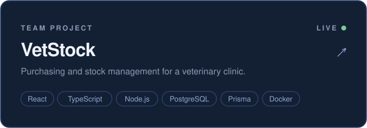
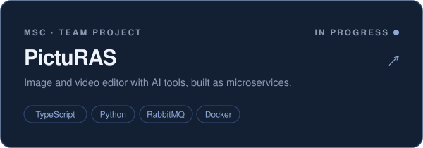
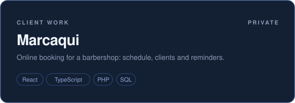
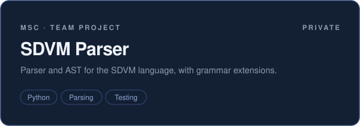

<picture>
  <source media="(prefers-color-scheme: dark)" srcset="assets/hero-dark.svg" />
  <source media="(prefers-color-scheme: light)" srcset="assets/hero-light.svg" />
  
</picture>

I build web applications and I'm interested in software quality, formal methods and AI.

 

#### Selected work

<a href="https://github.com/davidserreira/vetstock"><picture><source media="(prefers-color-scheme: dark)" srcset="assets/vetstock-dark.svg" /><source media="(prefers-color-scheme: light)" srcset="assets/vetstock-light.svg" /></picture></a>
<a href="https://github.com/davidserreira/picturas-27-extension"><picture><source media="(prefers-color-scheme: dark)" srcset="assets/picturas-dark.svg" /><source media="(prefers-color-scheme: light)" srcset="assets/picturas-light.svg" /></picture></a>

<picture><source media="(prefers-color-scheme: dark)" srcset="assets/marcaqui-dark.svg" /><source media="(prefers-color-scheme: light)" srcset="assets/marcaqui-light.svg" /></picture>
<picture><source media="(prefers-color-scheme: dark)" srcset="assets/sdvm-dark.svg" /><source media="(prefers-color-scheme: light)" srcset="assets/sdvm-light.svg" /></picture>

 

#### Activity

<picture>
  <source media="(prefers-color-scheme: dark)" srcset="https://raw.githubusercontent.com/davidserreira/davidserreira/output/activity-dark.svg" />
  <source media="(prefers-color-scheme: light)" srcset="https://raw.githubusercontent.com/davidserreira/davidserreira/output/activity-light.svg" />
  
</picture>

 

  <a href="https://www.linkedin.com/in/davidserreira"><picture><source media="(prefers-color-scheme: dark)" srcset="https://skillicons.dev/icons?i=linkedin&theme=dark" /><source media="(prefers-color-scheme: light)" srcset="https://skillicons.dev/icons?i=linkedin&theme=light" /></picture></a>
  &nbsp;&nbsp;
  <a href="mailto:davidserreira@gmail.com"><picture><source media="(prefers-color-scheme: dark)" srcset="https://skillicons.dev/icons?i=gmail&theme=dark" /><source media="(prefers-color-scheme: light)" srcset="https://skillicons.dev/icons?i=gmail&theme=light" /></picture></a>

